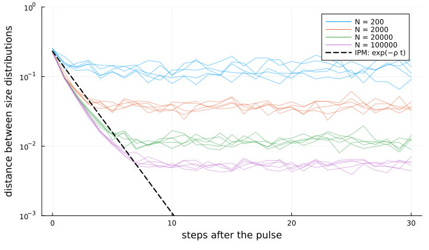

# Resilience of an individual-based population
Simon Frost

- [Overview](#overview)
- [The IPM and its resilience](#the-ipm-and-its-resilience)
- [A pulse: removing every juvenile](#a-pulse-removing-every-juvenile)
- [Estimating the return rate](#estimating-the-return-rate)
- [Caveats](#caveats)

## Overview

After a disturbance, how fast does a structured population return to its
usual composition? For the deterministic integral projection model (IPM)
the answer is a number: the population converges to its stable size
distribution at the rate `ln(λ₁/|λ₂|)` per step, from the two leading
eigenvalues of the kernel. This is the resilience that ResilienceCore.jl
computes for a projection matrix. The individual-based model (IBM) of
this package is that IPM’s finite-`N` realisation. This vignette
measures its return rate from simulations, and asks how close it comes
to the IPM’s value and how this depends on population size.

The simulation-based measure is `recovery` from DynamicalResilience.jl.
It works on any problem with SciML’s integrator interface. `IBMProblem`
gives the IBM that interface: its state is the population binned on the
IPM’s mesh, so IBM and IPM states can be compared directly.

``` julia
ENV["GKSwstype"] = "100"
using IndividualBasedPopulationDynamics
using IntegralProjectionModels
import StructuredPopulationCore as SPC
import ResilienceCore
using DynamicalResilience: recovery
using LinearAlgebra, Plots, Random, Statistics
```

## The IPM and its resilience

The vital rates of the first vignette: survival that does not depend on
size, growth towards `0.5 + 0.8z`, and recruits of size about 1.
Fecundity is set so that `λ₁ ≈ 1`. The population then neither grows nor
declines, so populations of different sizes keep their size during a
run.

``` julia
s = LinearSurvival(1.0, 0.0)                    # survival ≈ 0.731
g = NormalGrowth(0.5, 0.8, 0.4)
f = FecundityRate(-1.313, 0.0, 1.0, 0.3, 1.0)   # ≈ 0.269 recruits per individual
dom = SPC.ContinuousDomain(0.0, 6.0, 60)
kernel = PKernel(s, g, dom) + FKernel(f, dom)
A = ResilienceCore.linearise(IPMProblem(kernel, dom, ones(dom.n_meshpoints), (0, 1)))
ev = sort(abs.(eigvals(Matrix(A.A))); rev=true)
ρ = ResilienceCore.resilience(A)
(λ₁=round(ev[1]; digits=4), λ₂=round(ev[2]; digits=4), λ₃=round(ev[3]; digits=4),
 resilience=round(ρ; digits=3))
```

    (λ₁ = 0.9989, λ₂ = 0.5845, λ₃ = 0.4655, resilience = 0.536)

The IPM forgets a disturbance to its size distribution by a factor
`|λ₂|/λ₁ ≈ 0.59` per step. The third eigenvalue is not much smaller, so
straight after a disturbance the return is somewhat faster than `ρ`.

## A pulse: removing every juvenile

The population starts at the stable size distribution, scaled to `N`
individuals. At step 5 every juvenile (`z < 1.5`) is removed, for
example by a cohort failure. `recovery` runs the IBM twice, with and
without the pulse, and records the distance between the two size
*distributions* (proportions per bin). Before the pulse the second run
replays the first exactly (`reinit!` restarts the random number
generator). After it the two runs draw different random numbers, because
the populations differ. So the distance does not fall to zero: it stops
at a floor of sampling noise, of order `1/√N`.

``` julia
vals, vecs = eigen(Matrix(A.A))
w = abs.(real.(vecs[:, argmax(real.(vals))]))
stable(N) = N .* w ./ sum(w)
proportions(u) = u ./ max(sum(u), 1)
cull(u, rng) = (v = copy(u); v[1:15] .= 0; v)

Ns = (200, 2_000, 20_000, 100_000)
runs = Dict(N => [recovery(IBMProblem(VitalRates(s, g, f), stable(N), (0, 40); domain=dom,
                                      seed), IBMStepping();
                           perturb=cull, observe=proportions, t_pulse=5, horizon=30,
                           interval=1) for seed in 1:5]
            for N in Ns)

fig = plot(; yscale=:log10, xlabel="steps after the pulse",
           ylabel="distance between size distributions", legend=:topright,
           ylims=(1e-3, 1), size=(720, 420))
for (k, N) in enumerate(Ns)
    for r in runs[N]
        plot!(fig, r.t, r.distance; color=k, alpha=0.5, label="")
    end
    plot!(fig, [NaN], [NaN]; color=k, label="N = $N")
end
d0 = mean(r.distance[1] for N in Ns for r in runs[N])
plot!(fig, 0:30, d0 .* exp.(-ρ .* (0:30)); color=:black, ls=:dash, lw=2,
      label="IPM: exp(−ρ t)")
fig
```



The pulse moves the size distribution by 0.22 to 0.25 in every
population. The distance then falls at about the IPM’s rate until it
meets the noise floor: within a step or two for `N = 200`, and only
after about 6 steps for `N = 100 000`.

## Estimating the return rate

`recovery` fits the logarithm of the distance against time over a window
of distances, given as fractions of the initial one. A window that
reaches into the noise floor fits the floor, and the rate comes out near
zero. The floor of each run is estimated from its last ten distances.
The fit then uses only distances from the pulse itself down to twice the
floor:

``` julia
floor_of(r) = median(r.distance[(end - 9):end])
function return_rate(r)
    lo = 2 * floor_of(r) / r.distance[1]
    lo < 1 || return NaN                         # the floor is as large as the pulse
    keep = findall(d -> lo * r.distance[1] <= d <= r.distance[1], r.distance)
    length(keep) >= 3 || return NaN
    t, y = r.t[keep], log.(r.distance[keep])
    return -cov(t, y) / var(t)
end
naive(r) = r.return_rate                         # recovery's default window (0.1 to 1e-4)
[(N=N, floor=round(mean(floor_of, runs[N]); sigdigits=2),
  floor_times_sqrtN=round(mean(floor_of, runs[N]) * sqrt(N); digits=2),
  rate_above_floor=round.(return_rate.(runs[N]); digits=2),
  rate_default_window=round(mean(naive, runs[N]); digits=3)) for N in Ns]
```

    4-element Vector{@NamedTuple{N::Int64, floor::Float64, floor_times_sqrtN::Float64, rate_above_floor::Vector{Float64}, rate_default_window::Float64}}:
     (N = 200, floor = 0.13, floor_times_sqrtN = 1.87, rate_above_floor = [NaN, NaN, NaN, NaN, NaN], rate_default_window = NaN)
     (N = 2000, floor = 0.038, floor_times_sqrtN = 1.71, rate_above_floor = [NaN, NaN, NaN, NaN, NaN], rate_default_window = NaN)
     (N = 20000, floor = 0.012, floor_times_sqrtN = 1.69, rate_above_floor = [0.62, 0.66, 0.64, 0.68, 0.63], rate_default_window = 0.007)
     (N = 100000, floor = 0.0055, floor_times_sqrtN = 1.74, rate_above_floor = [0.6, 0.64, 0.65, 0.66, 0.59], rate_default_window = 0.016)

Three things stand out:

- **The noise floor scales as `1/√N`**, at about `1.7/√N`, as sampling
  noise between two populations of `N` individuals should.
- **Above the floor the IBM recovers at about the IPM’s rate.** With 20
  000 and 100 000 individuals the five estimates lie between 0.59 and
  0.68, 10 to 25% above `ρ ≈ 0.54`. The fit starts at the pulse, where
  the faster third mode (`ln(λ₁/|λ₃|) ≈ 0.76`) still contributes. At
  `N = 2 000` and `N = 200` fewer than three distances lie above twice
  the floor, and there is nothing to fit.
- **The default window fails.** `recovery`’s default window reaches down
  to `1e-4` of the pulse, deep into the floor. It returns no rate at all
  for the small populations and rates near zero (0.007 and 0.016) for
  the large ones. Choose the window from the floor, or average over
  replicates first.

## Caveats

- The IBM here is density-independent, as is its IPM: “recovery” means
  recovery of the size *distribution*, not of a population size. Total
  numbers neither return nor diverge (`λ₁ ≈ 1`).
- The common random numbers end at the pulse, because removing
  individuals changes the order in which the remaining ones draw random
  numbers. A coupling that kept the individuals’ own random streams
  would lower the floor.
- The pulse acts at the resolution of the mesh: `set_u!` removes
  individuals bin by bin.
